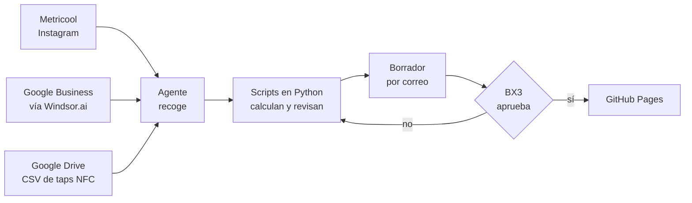

# Informes de Mood

Informe quincenal interactivo de redes sociales, stands NFC y fichas de Google para **Mood**, una heladería con tres islas en Barranquilla. Lo prepara un agente de IA cada semana, y una persona lo revisa y aprueba antes de publicarlo.

**Ver el informe:** https://shurtado26.github.io/mood-informes/

Hecho por Santiago Hurtado · BX3 Growth Agency · noviembre de 2026.

---

## El problema

Cada quincena había que juntar a mano tres fuentes distintas:

- **Instagram** (vistas, alcance, seguidores, publicaciones), desde Metricool.
- **Taps de los stands NFC** de cada isla: cuántas personas tocaron el stand y a qué botón entraron.
- **Fichas de Google Business** de las tres islas: búsquedas, vistas en Maps, rutas, llamadas y reseñas.

Después había que convertir esos datos en algo que los dueños, que no son analistas, pudieran leer en pocos minutos.

## La solución

### 1. Informe interactivo
Una sola página web con un enlace fijo. Cada quincena se suma a un selector, y las quincenas cerradas no se recalculan.

| Pestaña | Qué muestra |
|---|---|
| Resumen | Las cifras clave y los hallazgos de la agencia |
| El recorrido | Una línea animada de las vistas diarias, con la mascota de Mood al frente |
| Publicaciones | Cada pieza con sus vistas, alcance e interacción |
| Audiencia | Edad, género, ciudades y países |
| Taps NFC | Llegadas por isla, por hora y por botón |
| Google | Búsquedas, Maps, rutas, llamadas y reseñas por isla |
| Datos | De dónde sale cada cifra y qué no se puede medir |

### 2. Asistente «Pregúntale a Mood»
Responde preguntas frecuentes sobre el informe. Funciona con reglas, sin IA, y usa solo las cifras ya calculadas, así que no puede inventar datos. Hay una versión con IA construida, pero está apagada.

### 3. Agente semanal
Una tarea programada en Claude Code que corre los lunes, con un cierre los días 4 y 18:



1. Trae los datos de las tres fuentes por MCP.
2. Los scripts calculan las cifras y arman un borrador del informe.
3. Revisa el borrador: días sin datos, picos fuera de lo normal, datos atrasados, ráfagas de reseñas.
4. Envía el borrador por correo a la agencia, con las cifras y los avisos.
5. **No publica.** Publicar es un paso aparte que la agencia aprueba.

## Decisiones de diseño

- **La IA trae los datos, pero no calcula.** Todas las cifras salen de scripts que se pueden leer y repetir.
- **Una persona aprueba antes de publicar.** El agente solo escribe a la agencia, nunca al cliente.
- **«Sin medir» no es cero.** Si una isla no tiene un dato, el informe lo dice en vez de mostrar un 0.
- **El histórico no cambia.** Una quincena cerrada queda congelada.
- **Identidad de la marca.** Colores, tipografías y mascota salen del manual de marca de Mood.

## Limitaciones

- El agente corre en un computador local: si está apagado, no corre.
- Con la conexión actual, Metricool no entrega historias ni visitas al perfil.
- Google entrega los datos con unos tres días de atraso.
- El chip NFC solo se mide en una de las tres islas; en las otras se cuentan las visitas directas.

## Cómo está hecho

- **Sitio:** HTML, CSS y JavaScript sin librerías; gráficos en SVG; navegación por pestañas.
- **Datos:** un archivo por quincena en `datos/`, más un índice (`datos/indice.js`).
- **Agente y scripts** (fuera de este repositorio): Claude Code con conectores MCP de Metricool, Windsor.ai, Google Drive y Gmail, y scripts en Python.
- **Publicación:** GitHub Pages.

```
index.html        estructura y pestañas
app.js            interfaz, gráficos y asistente
estilos.css       estilos con la identidad de Mood
config.js         configuración del asistente con IA (vacío = apagado)
logo.js           logo de Mood
img/              mascota y stand
datos/            un archivo por quincena + índice
```

Para verlo en local, sirve la carpeta con cualquier servidor estático:

```
python -m http.server 8347
```

## Quién hizo qué

Santiago Hurtado definió el problema, las fuentes, las reglas del agente y los criterios de revisión, y aprueba cada publicación. Claude Code escribió el código y ejecuta el agente bajo esas reglas.

---

Los datos publicados son agregados del negocio y no incluyen información personal de clientes.
